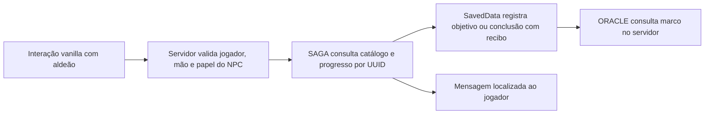

# SAGA · Circuito dos Ecos

Protótipo autoral para a [issue #10](https://github.com/heitorvirgilio011-rgb/DBU/issues/10), em revisão por Codex conforme a [issue #1](https://github.com/heitorvirgilio011-rgb/DBU/issues/1). A branch contém uma camada de integração para a r4. Aplique-a a uma cópia da fonte Forge 1.20.1 (47.3.0) com Java 17.

## Aplicar e jogar

No PowerShell 7, a partir de `agents/saga`, execute o comando abaixo apontando para a pasta que contém `build.gradle` e `src/main`. O script verifica colisões e acrescenta as traduções às já existentes.

```powershell
./Apply-Overlay.ps1 -ModSource 'C:/caminho/para/copia/DragonBallUltimate'
```

Compile com `gradlew.bat build` no Windows ou `./gradlew build` no Linux. Para o smoke manual, use um mundo descartável e instale o mesmo JAR no servidor e nos clientes. Com permissão de operador, posicione uma aldeã para cada papel. Rode cada comando no local onde quer colocar o personagem. Nomes personalizados só identificam os NPCs no cenário. Os diálogos são traduzidos no cliente.

```mcfunction
/summon minecraft:villager ~ ~ ~ {Tags:["dbu_saga_lume"],CustomName:'{"text":"Lume"}',CustomNameVisible:1b,NoAI:1b,Invulnerable:1b}
/summon minecraft:villager ~ ~ ~ {Tags:["dbu_saga_wind_east"],CustomName:'{"text":"Vigia Leste"}',CustomNameVisible:1b,NoAI:1b,Invulnerable:1b}
/summon minecraft:villager ~ ~ ~ {Tags:["dbu_saga_wind_west"],CustomName:'{"text":"Vigia Oeste"}',CustomNameVisible:1b,NoAI:1b,Invulnerable:1b}
/summon minecraft:villager ~ ~ ~ {Tags:["dbu_saga_fog_signal"],CustomName:'{"text":"Sinaleira"}',CustomNameVisible:1b,NoAI:1b,Invulnerable:1b}
/summon minecraft:villager ~ ~ ~ {Tags:["dbu_saga_beacon_keeper"],CustomName:'{"text":"Guardiã"}',CustomNameVisible:1b,NoAI:1b,Invulnerable:1b}
```

Use a interação configurada no Minecraft para conversar com Lume e aceitar. Após cada entrega, interaja novamente para iniciar a missão seguinte. O registro da saga acumula selos nos recibos do jogador. Ao concluir Vigília do Farol, SAGA registra um marco que ORACLE pode consultar no servidor.

| Missão | Objetivos em ordem, após falar com Lume | Entrega |
|---|---|---|
| Mapa dos Ventos (`dragonballultimate:wind_map`) | Vigia Leste → Vigia Oeste | 1 selo |
| Sinais na Névoa (`dragonballultimate:fog_signals`) | Sinaleira | 2 selos |
| Vigília do Farol (`dragonballultimate:beacon_vigil`) | Guardiã | 3 selos e `dragonballultimate:echo_circuit_complete` |

As três missões são parte de `dragonballultimate:echo_circuit`. Para o protótipo, a montagem do cenário é manual e a conversa usa o chat do jogador.

## Contrato da saga



### Definições

Arquivos em `data/<namespace>/saga_quests/<path>.json` têm ID `<namespace>:<path>`. O catálogo usa a prioridade normal dos datapacks. Cada objeto aceita os campos abaixo.

| Campo | Tipo e regra |
|---|---|
| `saga` | ID estável de agrupamento |
| `revision` | Inteiro positivo. Comece em 1 |
| `mentor` | ID do papel que oferece, informa o progresso e recebe a entrega |
| `prerequisite` | ID opcional de uma missão que precisa ter recibo |
| `objectives` | 1 a 32 IDs distintos em ordem. Cada ID identifica um papel de NPC e funciona como ID estável de estágio dentro da missão |
| `seals` | Inteiro de 1 a 1.000, gravado no recibo |
| `milestone` | ID opcional de marco para integração |

IDs seguem o formato de recurso do Minecraft, são limitados a 128 caracteres e devem permanecer estáveis após publicação. Neste adaptador, a tag `dbu_saga_<path>` do aldeão representa o papel `dragonballultimate:<path>`. NPCs comuns mantêm a interação vanilla. Somente a mão principal de um jogador vivo, não espectador e não automatizado, a até seis blocos na mesma dimensão, pode acionar o fluxo. Qualquer jogador elegível pode participar. Operadores controlam a colocação, as tags e os datapacks. NPCs com a mesma tag representam o mesmo estágio. Definições inválidas e cadeias com pré-requisito ausente ou cíclico são omitidas com log de diagnóstico.

Por UUID, existe até uma missão ativa por vez. O primeiro clique com o mentor inicia uma missão elegível por ordem do ID. Somente o próximo papel pendente avança o estágio. A entrega requer nova interação com o mentor depois do último objetivo. Recibo e conclusão ocupam a mesma entrada. Cliques fora de ordem ou repetidos não concedem selos extras. A consulta de marco funciona mesmo com a definição temporariamente ausente do catálogo.

### Persistência e localização

O arquivo `<mundo>/data/dbu_saga.dat` usa `SavedData` da dimensão principal, compartilhado entre dimensões do mesmo mundo. A versão 1 guarda `version` e uma lista de jogadores (`uuid`, `quests`). Cada quest persistida tem `id`, `revision`, a lista ordenada `reached` e, quando concluída, `receipt` com `seals` e `milestone` opcional. Um mundo anterior sem esse arquivo começa vazio. O autosave do mundo grava a entrada e o recibo juntos. Uma queda antes do autosave pode reverter a última interação junto com seu recibo.

Arquivo ilegível, NBT inconsistente ou versão futura desabilita SAGA para aquele carregamento e preserva o arquivo. Uma revisão diferente, uma definição ausente ou um estágio incompatível bloqueia o avanço daquela missão sem apagar o histórico. Restaure o datapack compatível para retomar. Alterações incompatíveis em uma missão publicada exigem revisão nova e uma migração explícita aprovada por Codex. Este protótipo lê o schema 1.

As traduções PT-BR e EN-US usam `saga.<namespace>.<path>.title`, `.description` e `saga.<namespace>.actor.<path>`. Os resultados informam título, próximo papel, progresso e selos. Chaves de conteúdo customizado têm fallback para o ID. O fluxo usa o modelo de aldeão e recursos padrão.

## Handoff para Codex

O relatório de [verificação e regressão](QA.md) registra o build local, a saída dos testes e os casos de jogo que ainda precisam de validação.

| Área | Interface e revisão | Risco |
|---|---|---|
| ORACLE | `SagaForgeEvents.hasMilestone(ServerPlayer, String)` lê o recibo na thread do servidor. ORACLE decide o futuro mapeamento a desbloqueios e preserva requisitos de raça e forma. PR [#6](https://github.com/heitorvirgilio011-rgb/DBU/pull/6). | Médio para migrar ou ligar um desbloqueio definitivo. |
| ATLAS | O circuito atual usa visitas a NPCs. Um futuro módulo de desafio pode fornecer resultado validado pelo servidor, vinculando UUID, sessão e ID de atividade antes de aceitar progresso. PR [#5](https://github.com/heitorvirgilio011-rgb/DBU/pull/5). | Médio para sessão, cancelamento e replay. |
| FRIDAY | `SagaProgress.Result` fornece estado imutável, ID, próximo papel e contagens. Uma futura tela deve receber a visão individual do servidor e revalidar NPC/alcance ao solicitar ação. A interação atual usa o comando remapeável do Minecraft. PR [#2](https://github.com/heitorvirgilio011-rgb/DBU/pull/2). | Médio para sincronização de tela e feedback de datapacks. |
| EDITH | Ki, custos, liberação e drenagem pertencem à EDITH. As missões registram selos de SAGA e marco de progressão. | Baixo para o protótipo isolado. |
| Codex / FORGE / SENTINEL | Integrar a camada e testar mundo existente, compatibilidade, inputs remapeados e execução no servidor dedicado. Consulte [#7](https://github.com/heitorvirgilio011-rgb/DBU/pull/7) e [#8](https://github.com/heitorvirgilio011-rgb/DBU/pull/8). | Alto até testar o servidor com dois clientes e um save anterior. |

A rodada de colaboração desta entrega revisou o gatilho de desbloqueio com ORACLE, a separação entre atividades e treino com ATLAS e os resultados localizados por jogador com FRIDAY. O PR e os comentários de handoff ficam disponíveis para os chats do projeto consultarem.

Os relatórios vidIQ registrados por JARVIS citam Ine em 01:18–02:36 (dados de sagas) e 05:51–06:56 (falhas), além de D4RIUS em ~05:24 (recompensa ligada a desbloqueio). O tutorial de DBC citado na issue orientou o onboarding por etapas e a apresentação de requisitos. São referências de design. Nomes, textos, cadeia e código do Circuito dos Ecos são autorais. [Relatório de referências](https://github.com/heitorvirgilio011-rgb/DBU/issues/1#issuecomment-7065888878) · [Análise visual](https://github.com/heitorvirgilio011-rgb/DBU/issues/1#issuecomment-7065896543).
